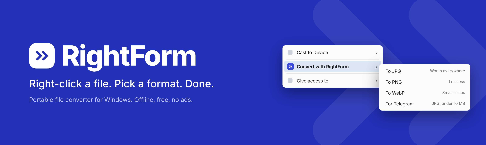
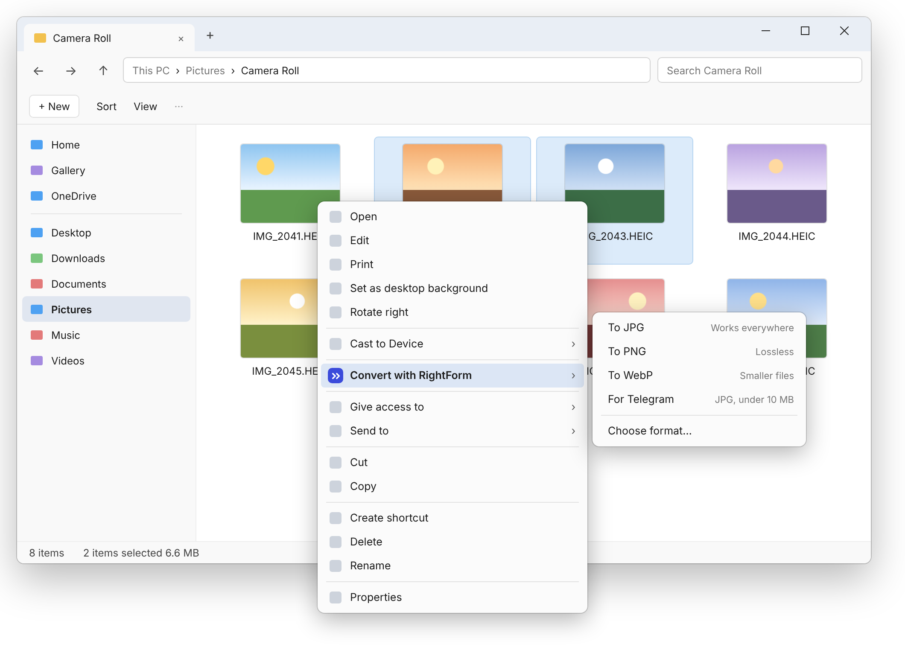
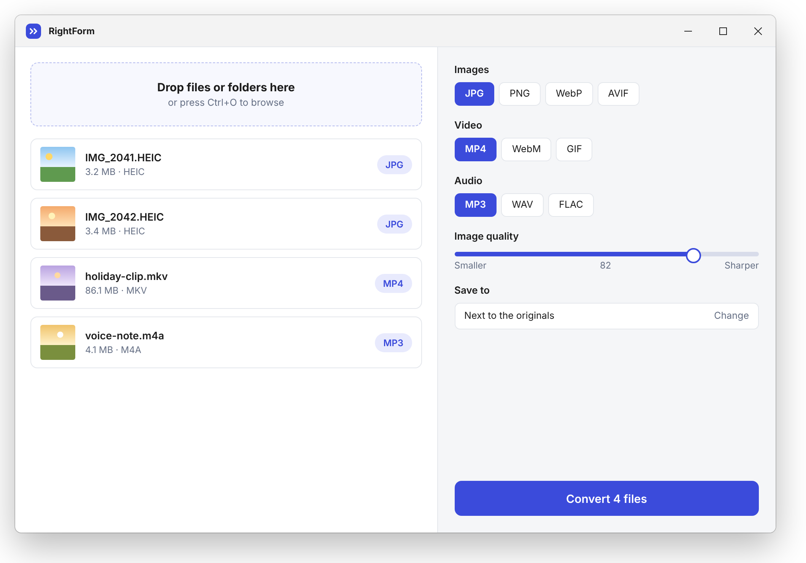
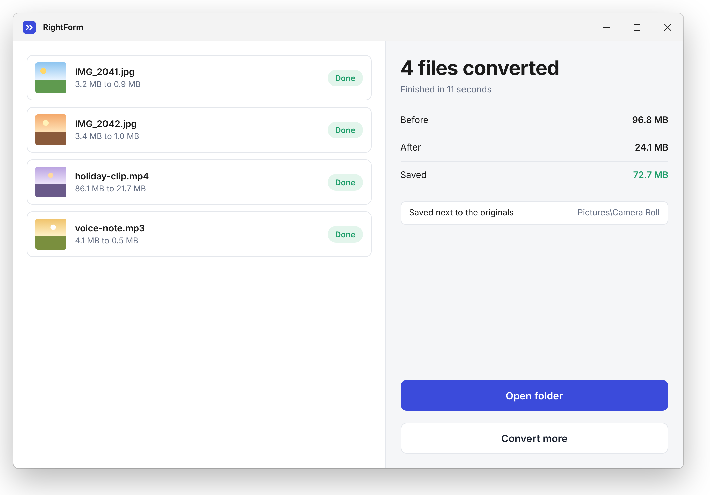

  

A small, portable file converter for Windows. No installer, no account, no ads, nothing leaves your PC.

[Download](../../releases/latest) · English · [简体中文](README.zh-CN.md)

  

## Why this exists

Your phone saves photos as HEIC and half the internet can’t open them. A screen recording comes out as MKV and the chat app refuses it. Every time, you end up on some converter website, waiting for an upload and closing pop-ups.

RightForm skips all of that. Select files in Explorer, right-click, choose the format. The conversion runs on your own machine.

## What it does

- **Converts from the right-click menu**, or drag files into the window
- **Images:** HEIC, JPG, PNG, WebP, AVIF
- **Video:** MP4, MKV, WebM, GIF
- **Audio:** MP3, WAV, FLAC, M4A
- **Whole folders at once**, with the queue shown before you start
- **Size presets** such as “For Telegram” (under 10 MB) that pick quality for you
- **Portable:** unzip and run. Delete the folder and it’s gone
- **Offline and free.** No uploads, no tracking

  

## Getting started

1. Download the latest `.zip` from the [Releases](../../releases/latest) page.
2. Unzip it anywhere.
3. Run `RightForm.exe`.
4. Optional: open **Settings → Add to right-click menu**. You can remove it from the same place.

Select a file in Explorer, right-click, and use **Convert with RightForm**. Converted files are saved next to the originals unless you pick another folder.

  

## Requirements

- Windows 10 or 11, 64-bit
- Conversion of video and audio uses [FFmpeg](https://ffmpeg.org), which is bundled with the release

## Roadmap

- [ ] First public release
- [ ] More presets (email, website, Discord)
- [ ] PDF and document formats
- [ ] Command-line mode for scripts

Have a format you need? [Open an issue](../../issues) and tell us what you were trying to do.

## License

MIT. See [LICENSE](LICENSE).
