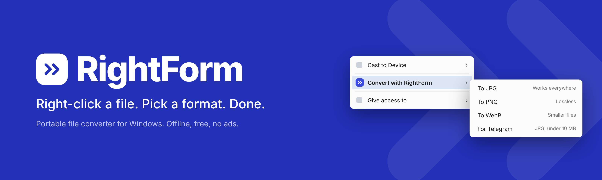
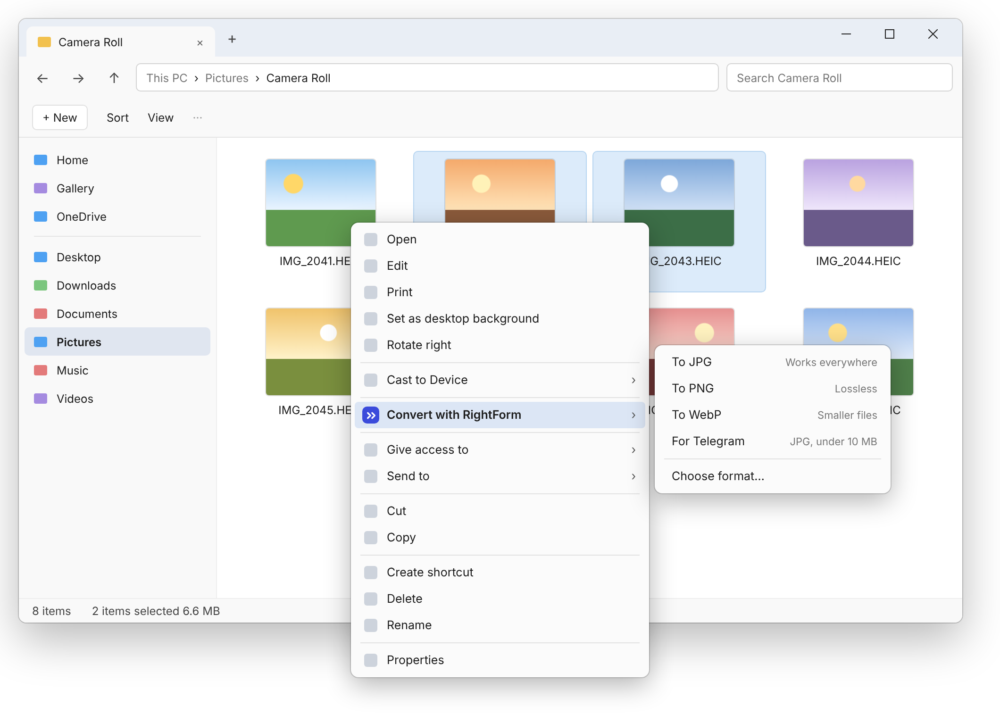
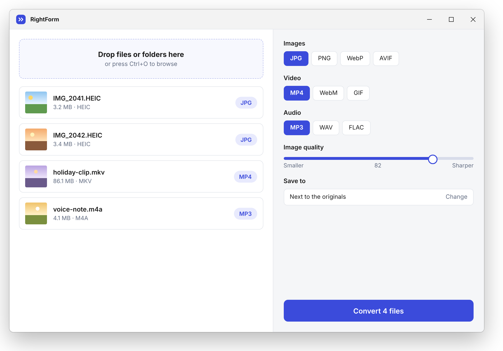
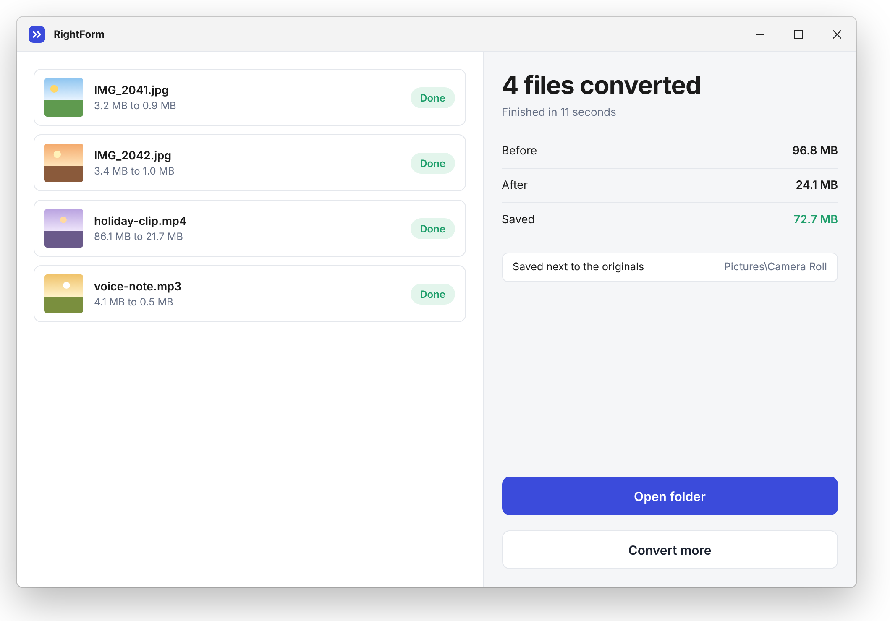

  

一款小巧的 Windows 便携式文件转换工具。无需安装、无需注册、没有广告，文件始终留在你的电脑上。

[下载](../../releases/latest) · [English](README.md) · 简体中文

  

## 为什么做这个

手机拍的照片是 HEIC 格式，很多地方打不开。录屏出来是 MKV，聊天软件又不收。每次都得跑去某个在线转换网站，等上传、关弹窗，还要担心文件被传到别人的服务器上。

RightForm 把这些步骤都省掉了：在资源管理器里选中文件，右键，选格式。转换全部在你自己的电脑上完成。

## 功能

- **右键菜单直接转换**，也可以把文件拖进窗口
- **图片：** HEIC、JPG、PNG、WebP、AVIF
- **视频：** MP4、MKV、WebM、GIF
- **音频：** MP3、WAV、FLAC、M4A
- **整个文件夹一次处理**，开始前可以先看到队列
- **体积预设**，比如“发给 Telegram”（10 MB 以内），自动帮你选画质
- **绿色便携：** 解压即用，删掉文件夹就彻底清除
- **离线、免费**，不上传、不追踪

  

## 快速开始

1. 在 [Releases](../../releases/latest) 页面下载最新的 `.zip` 压缩包。
2. 解压到任意位置。
3. 运行 `RightForm.exe`。
4. 可选：打开 **设置 → 添加到右键菜单**，同一位置也可以移除。

在资源管理器中选中文件，右键选择 **Convert with RightForm** 即可。转换后的文件默认保存在原文件旁边，也可以改到其他文件夹。

  

## 系统要求

- Windows 10 或 11（64 位）
- 视频和音频转换使用 [FFmpeg](https://ffmpeg.org)，发布包中已内置

## 开发计划

- [ ] 发布第一个正式版本
- [ ] 更多预设（邮件、网站、Discord）
- [ ] 支持 PDF 和文档格式
- [ ] 命令行模式，方便脚本调用

需要其他格式？欢迎[提交 issue](../../issues)，告诉我们你想做什么。

## 许可证

MIT，详见 [LICENSE](LICENSE)。
